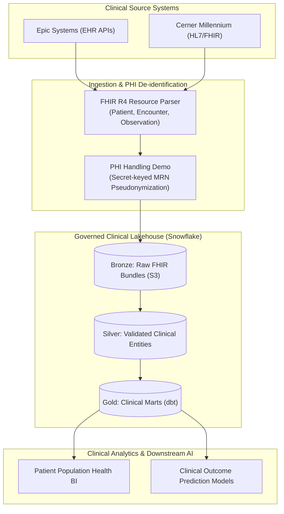

# Healthcare FHIR Lakehouse & Clinical Analytics Platform

[](https://opensource.org/licenses/MIT)
[](https://www.python.org/downloads/)
[](https://hl7.org/fhir/R4/)
[](https://www.snowflake.com/)
[](https://www.getdbt.com/)
[](#privacy-and-security-scope)

> **Clinical data platform reference implementation** demonstrating synthetic FHIR R4 parsing, clinical quality checks, privacy-aware pseudonymization examples, and Snowflake/dbt/Airflow lakehouse design patterns. The sample data is synthetic and does not connect to live Epic or Cerner systems.

---

## 🏗️ Architecture & Clinical Pipeline



---

## 🚀 Key Architectural Features

* **FHIR R4 & HL7 Interoperability**: Standardized parsers decomposing complex nested JSON bundles into relational tables.
* **Defensive Bundle Parsing**: Safely skips malformed entries and handles empty optional FHIR collections without aborting valid records in the same batch.
* **Secret-keyed MRN Pseudonymization**: Deterministic HMAC-SHA256 tokens use a runtime key instead of a salt committed to source control.
* **Clinical Data Contracts**: Validates the supported LOINC observation codes and returns record-level diagnostics.
* **dbt Dimensional Modeling**: Production marts for patient longitudinal views, inpatient length-of-stay, and chronic disease cohorts.
* **Airflow Workflow Orchestration Design**: Example clinical ingestion scheduling patterns. The 30% reliability improvement described in my resume refers to professional work, not a benchmark measured in this sample project.

---

## 📂 Project Structure

```
healthcare-fhir-lakehouse-platform/
├── .github/workflows/ci.yml           # GitHub Actions regression checks
├── dags/
│   └── fhir_ingestion_dag.py          # Airflow clinical ingestion DAG
├── dbt_project/                       # dbt Core models
│   ├── dbt_project.yml
│   └── models/
│       ├── staging/
│       │   ├── stg_fhir_patients.sql
│       │   └── stg_fhir_encounters.sql
│       └── marts/
│           ├── dim_patients.sql
│           ├── fct_clinical_observations.sql
│           └── schema.yml
├── docs/architecture.md               # Clinical Lakehouse architecture
├── sample_data/
│   └── fhir_bundle.json               # Sample FHIR R4 Bundle
├── src/
│   ├── __init__.py
│   ├── fhir/
│   │   └── parser.py                  # FHIR R4 bundle parser
│   ├── governance/
│   │   └── phi_masker.py              # MRN pseudonymization helper
│   └── quality/
│       └── data_contracts.py          # Clinical vocabulary validator
├── tests/
│   └── test_fhir_pipeline.py          # Unit tests
├── docker-compose.yml
├── requirements.txt
└── .gitignore
```

---

## ⚡ Quickstart

```bash
git clone https://github.com/devmasonmir/healthcare-fhir-lakehouse-platform.git
cd healthcare-fhir-lakehouse-platform
python -m venv venv
.\venv\Scripts\activate
pip install -r requirements.txt
python -m unittest discover -s tests -v
```

The GitHub Actions workflow runs compilation, linting, and the dependency-free
regression suite on Python 3.10 and 3.12 for pushes to `main` and pull requests.
Run the same core checks locally with:

```bash
python -m compileall -q src tests
flake8 src tests --max-line-length=120
python -m unittest discover -s tests -v
```

Set a secret of at least 32 bytes before pseudonymizing MRNs. Use a secret manager
in deployed environments; do not commit the value:

```bash
export PHI_PSEUDONYMIZATION_KEY="replace-with-a-secret-of-at-least-32-bytes"
```

The parser treats missing or empty optional `identifier`, `coding`, `subject`, and
`valueQuantity` elements as null fields. Non-object entries are skipped so one
malformed resource does not prevent valid resources in the same synthetic bundle
from being processed.

The observation data contract accepts a list of parsed observation objects. It reports
missing or unsupported LOINC codes and malformed records by input index, while a
non-list batch raises `TypeError` before validation starts.

## Privacy and security scope

This repository is an educational reference implementation that uses synthetic
data. MRN pseudonymization alone is not HIPAA Safe Harbor de-identification and
does not establish regulatory compliance. A production deployment needs a formal
risk assessment, key rotation, access controls, audit logging, retention rules,
and handling for every identifier present in its data.

---

## Scope and licensing

Independent portfolio reference implementation using synthetic data, not employer systems or clinical records. No license file is currently included.

